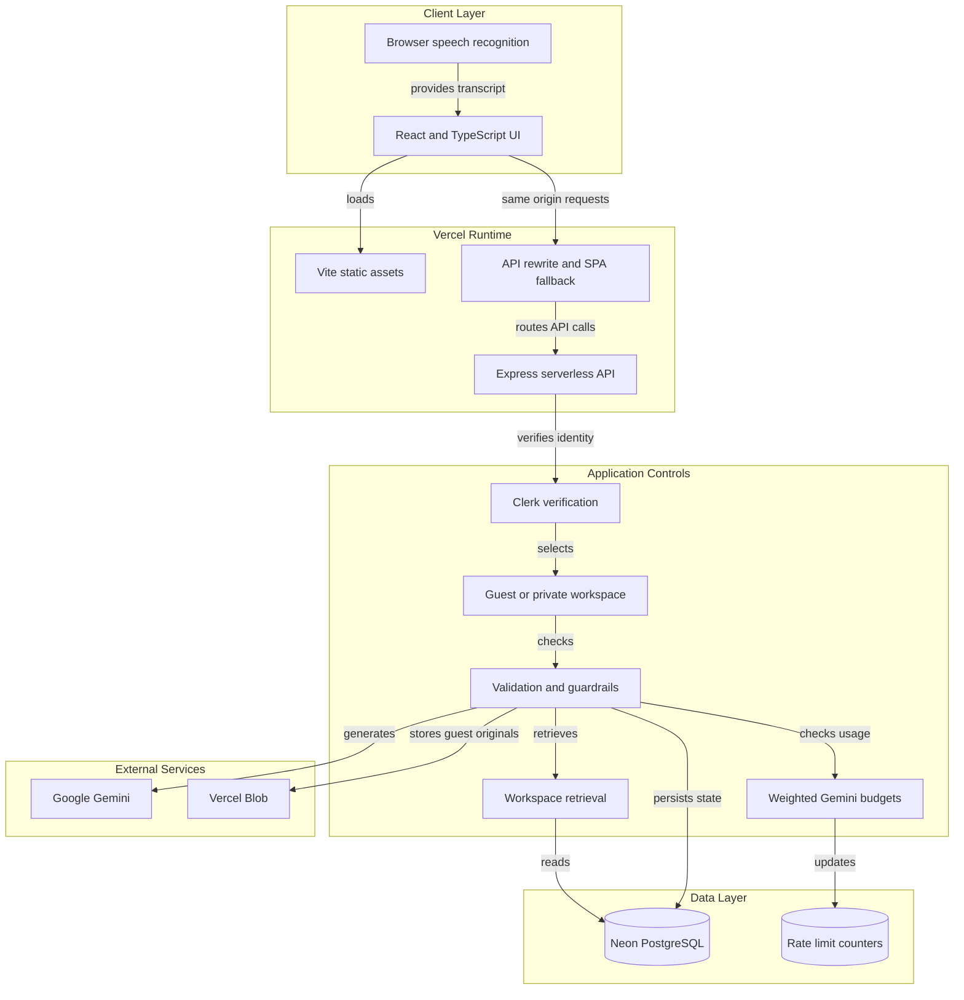

# Architecture Diagram

ActionFlow AI is a React and TypeScript client deployed with a Vercel serverless Express API. The application combines Clerk identity, workspace-scoped Neon persistence, optional Gemini generation, deterministic safety controls, lightweight retrieval, and bounded usage budgets.

## Application Architecture

<!-- mermaid-checked: no \n, no em-dash/en-dash, no {} in labels, subgraphs are id["label"], arrows are -->|"label"|, all subgraphs closed by end, ids unique -->

### Technology Stack Summary

| Layer | Technology | Version | Purpose |
| --- | --- | --- | --- |
| Client | React | 19 | Browser workspace UI |
| Client | TypeScript | 5.8 | Type-safe application code |
| Build | Vite | 6 | Frontend development and bundling |
| UI | Tailwind CSS | 4 | Styling and responsive layout |
| API | Node.js | 20+ | Server runtime |
| API | Express | 4 | HTTP routing and middleware |
| Identity | Clerk | Current project SDK | Session verification and private workspace identity |
| AI | Google Gemini through `@google/genai` | Current project SDK | Optional structured analysis and refinement |
| Data | Neon PostgreSQL | Hosted service | Durable JSONB workspace state and counters |
| Hosting | Vercel | Hosted platform | Static frontend, serverless API, rewrites, and deployment |
| Files | Vercel Blob | Hosted service | Optional public guest originals |

### Data Storage & External Services

Neon stores versioned JSONB snapshots for guest and private workspaces and stores atomic counters in `api_rate_limits` so request and Gemini budgets remain consistent across Vercel instances. Clerk verifies signed-in identity. Gemini is optional and is protected by weighted per-minute and rolling daily workflow budgets. Vercel Blob is optional and is used only for public guest originals; authenticated uploads retain indexed text privately. When Gemini is unavailable, the server uses a deterministic heuristic fallback.

### Key Architectural Decisions

- The Vercel entry point lazy-loads the Express application so local Vite startup code is not imported into the serverless function.
- Same-origin API rewrites keep browser requests on the deployment domain and route `/api/*` before the SPA fallback.
- Validation, safety checks, workspace isolation, and usage budgets are server-authoritative and execute before model generation.

## Component Relationships

```mermaid
flowchart LR
    subgraph Presentation["Presentation"]
        cApp["React application"]
        cAssistant["Assistant page"]
        cSettings["Settings page"]
        cApiClient["Browser API client"]
    end
    subgraph Middleware["API Middleware"]
        cEntry["Vercel entry"]
        cExpress["Express app"]
        cHeaders["Security headers"]
        cClerk["Clerk middleware"]
        cScope["Scope preparation"]
        cLimits["Rate limit middleware"]
    end
    subgraph Business["Business Logic"]
        cValidate["Request validation"]
        cGuard["Safety guardrails"]
        cRag["RAG service"]
        cGemini["Gemini service"]
        cFallback["Heuristic fallback"]
        cActions["Task and audit routes"]
    end
    subgraph DataAccess["Data Access"]
        cDb["Database service"]
        cState[("Workspace JSONB state")]
        cRate[("Rate limit state")]
    end

    cApp -->|"renders"| cAssistant
    cApp -->|"renders"| cSettings
    cAssistant -->|"uses"| cApiClient
    cSettings -->|"uses"| cApiClient
    cApiClient -->|"calls"| cEntry
    cEntry -->|"lazy loads"| cExpress
    cExpress -->|"adds"| cHeaders
    cHeaders -->|"authenticates"| cClerk
    cClerk -->|"prepares"| cScope
    cScope -->|"limits"| cLimits
    cLimits -->|"validates"| cValidate
    cValidate -->|"checks risk"| cGuard
    cValidate -->|"retrieves context"| cRag
    cRag -->|"reads"| cDb
    cValidate -->|"runs"| cGemini
    cGemini -.->|"unavailable"| cFallback
    cGemini -->|"persists result"| cDb
    cFallback -->|"persists result"| cDb
    cExpress -->|"serves"| cActions
    cActions -->|"reads and writes"| cDb
    cDb -->|"stores"| cState
    cDb -->|"stores"| cRate
```

<!-- mermaid-checked: no \n, no em-dash/en-dash, no {} in labels, subgraphs are id["label"], arrows are -->|"label"|, all subgraphs closed by end, ids unique -->

### Component Inventory

| Component | Layer | Type | Responsibility |
| --- | --- | --- | --- |
| React application | Presentation | SPA shell | Owns navigation, workspace state, and shared settings |
| Assistant page | Presentation | UI page | Captures transcript, submits analysis, and displays evidence |
| Browser API client | Presentation | Service client | Sends same-origin requests and handles API errors |
| Vercel entry | Middleware | Serverless entry point | Lazy-loads the Express application |
| Express app | Middleware | HTTP application | Registers routes, headers, logging, and middleware |
| Clerk middleware | Middleware | Authentication middleware | Verifies server-side Clerk sessions |
| Scope preparation | Middleware | Workspace middleware | Selects guest or verified user storage scope |
| Rate limit middleware | Middleware | Abuse-control middleware | Enforces general, expensive-route, and Gemini budgets |
| Request validation | Business Logic | Validation service | Bounds and validates API input |
| Safety guardrails | Business Logic | Policy service | Detects risky operations and preserves confirmation requirements |
| RAG service | Business Logic | Retrieval service | Scores and returns relevant workspace knowledge |
| Gemini service | Business Logic | Provider adapter | Calls configured models with bounded retry and fallback |
| Heuristic fallback | Business Logic | Deterministic analyzer | Keeps basic analysis available without Gemini |
| Database service | Data Access | Persistence abstraction | Reads and writes scoped workspace state and counters |
| Workspace JSONB state | Data Access | PostgreSQL storage | Stores tasks, analyses, settings, knowledge, and audit records |
| Rate limit state | Data Access | PostgreSQL storage | Stores atomic rolling-window counters |
